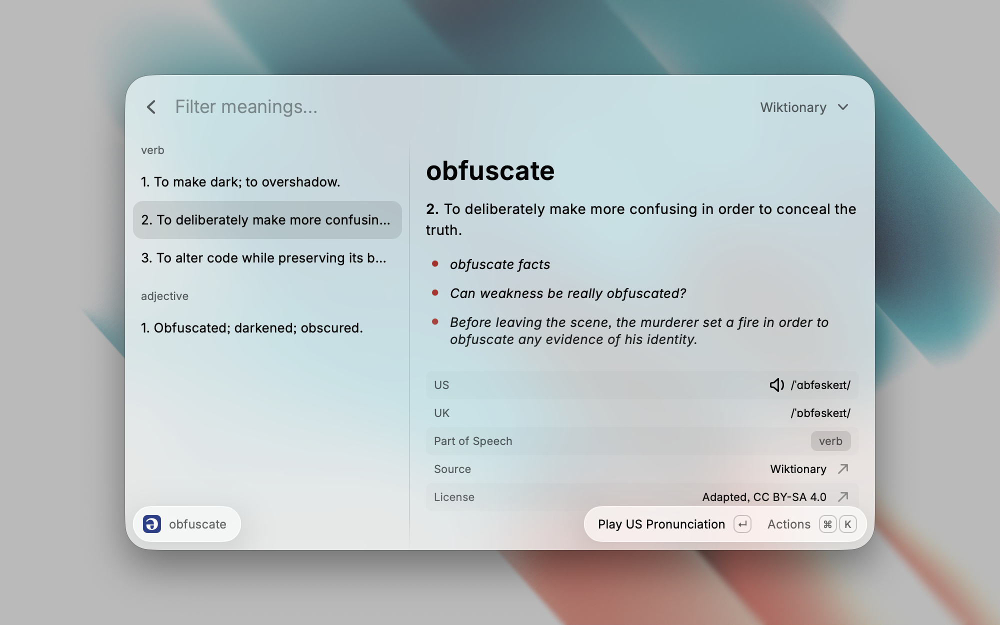

# English Dictionary

Look up English words in Wiktionary, Collins and Merriam-Webster, and hear them pronounced, from Raycast.

## Commands

- **Search Word**: type a word or phrase and press Enter to open its entry. Each meaning sits on the left, grouped by part of speech. The right side shows its definition and examples, and a picture when the dictionary has one, with the pronunciation and usage labels underneath. Enter plays a recording of the word when the dictionary has one, and Copy Definition takes the meaning with you. Your recent words appear as you type, and all of them when the search bar is empty.
- **Define Selected Word**: open the entry for the text selected in the frontmost app. With nothing selected, it reads the clipboard when it holds a short phrase, and the entry says so. Give it a hotkey in Raycast Settings to look up any word in one keystroke.

Each lookup opens in your **Default Dictionary**. Press ⌘P to switch dictionaries until Raycast returns to its root search.

To skip a step, type the word right after the command in Raycast's root search, or add Search Word as a fallback command in Raycast Settings so a word typed in root search opens straight away.

Every entry also offers **Open in Other Dictionary…** (⌘⇧O) for Oxford Learner's, Cambridge, Longman, Vocabulary.com, Urban Dictionary and the OED, which open the word on that dictionary's own site.

## Setup

Wiktionary works right away. Collins and Merriam-Webster each need a key of your own, and stay hidden until it is entered.

1. Merriam-Webster: register at [dictionaryapi.com](https://dictionaryapi.com/register/index), choose the Learner's or the Collegiate dictionary, and copy the key from **My Keys**. Paste it into **Merriam-Webster API Key**, and choose the same dictionary under **Merriam-Webster Dictionary**.
2. Collins: request a key at [collinsdictionary.com](https://www.collinsdictionary.com/collins-api/). Paste it into **Collins API Key**, and choose the dictionary it covers under **Collins Dictionary**.

Both keys are for personal, non-commercial use. A free Merriam-Webster key allows 1,000 lookups a day, and Collins lists its own limits on its API page.

## Limitations

- Oxford Learner's forbids copying its entries without written permission, Cambridge, Longman and Vocabulary.com forbid automated access to their sites, and Urban Dictionary allows its API only with permission, so their entries are not shown here. **Open in Other Dictionary…** takes you to the word on their own site instead.
- The Oxford English Dictionary needs a subscription, so its entry in **Open in Other Dictionary…** opens its search page.
- Collins results are never cached, because its terms forbid it, so opening a Collins entry again fetches it again.
- Wiktionary lookups are lowercase, so a word Wiktionary lists only with a capital letter, such as a place name, is not found. Wiktionary offers no spelling suggestions after a miss.

## Privacy

Lookups go straight from your Mac to the dictionary you chose, only when you ask for a word. Collins asks for spelling suggestions after a miss. Requests to Wiktionary and Merriam-Webster name the extension and its source repository, as Wikimedia asks of every app that uses its API. The extension keeps only your recent words and your settings. A pronunciation clip is written to a temporary file and deleted after it plays.

## Terms and Attribution

This extension is unofficial and is not affiliated with or endorsed by the Wikimedia Foundation, Oxford University Press, HarperCollins Publishers, Merriam-Webster, Inc., Cambridge University Press, Pearson, IXL Learning or Urban Dictionary.

Wiktionary entries are shared under the [Creative Commons Attribution-ShareAlike 4.0 license](https://creativecommons.org/licenses/by-sa/4.0/). The extension shortens them, so each one shows "Adapted, CC BY-SA 4.0" in its License row, linked to the license, and its Source row opens the original page.

Collins and Merriam-Webster entries show the notice their publisher requires: "www.collinsdictionary.com © HarperCollins Publishers Ltd 2025", or the Merriam-Webster logo. Merriam-Webster® and Collegiate® are registered trademarks of Merriam-Webster, Inc.
