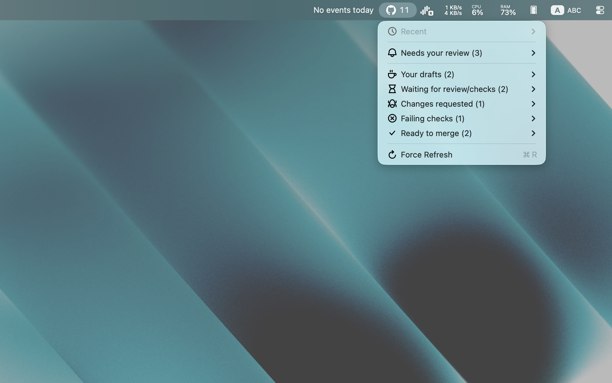

# GitHub Review Requests

See the pull requests waiting on you from the menu bar, and search your review requests.

This is a fork of the [Raycast GitHub Review Requests extension](https://github.com/raycast/extensions/tree/main/extensions/github-review-requests). It ships two commands: **My Pull Requests** in the menu bar, and **Search Review Requests**.

## What this fork changes

The menu bar mirrors your [GitHub pull requests dashboard](https://github.com/pulls), so you always know who is waiting on you and where your own PRs stand:

- Six categories, each a GitHub search: Needs your review, Your drafts, Waiting for review/checks, Changes requested, Failing checks and Ready to merge.
- Each count is GitHub's true total for that search.

## Install

1. Clone this repository.
2. In the `github` folder, run `npm install`.
3. Open Raycast, run **Import Extension**, and select the `github` folder.

## Sign in

1. Create a classic token at https://github.com/settings/tokens with the scopes `repo`, `read:org`, `read:user`, `read:email` and `project`.
2. Paste it into the extension's **Personal Access Token** preference.

To limit the pull requests to some organizations or owners, list them, separated by commas, in the **Organizations/Owners** preference.

## Credits

Based on the Raycast GitHub Review Requests extension by [resessh](https://github.com/resessh) and contributors, released under the MIT License.
