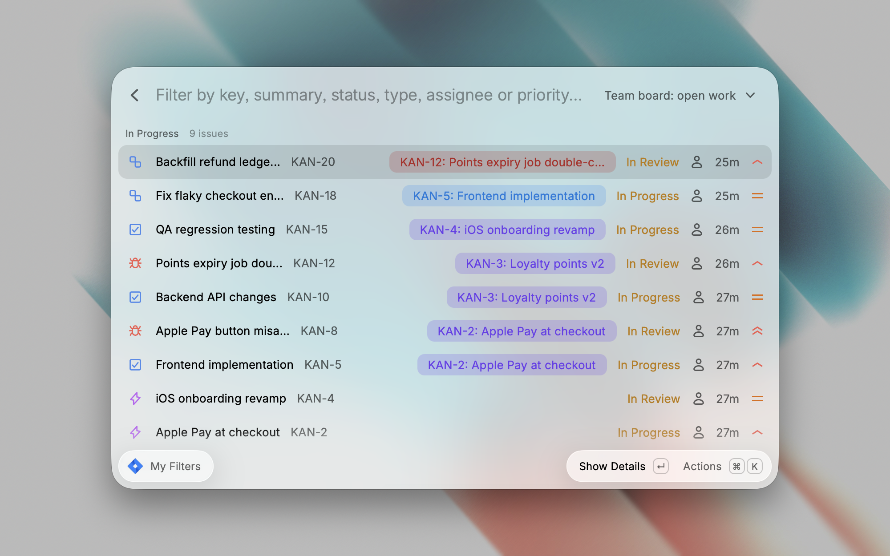

# Jira

Browse your saved Jira filters, with each issue's parent shown on the list.

This is a fork of the [Raycast Jira extension](https://github.com/raycast/extensions/tree/main/extensions/jira). It ships one command, **My Filters**, which lists the issues of any filter you saved or starred in Jira.

## What this fork changes

When a filter holds many issues with the same title, such as "Frontend implementation" under every epic, the upstream list makes them look identical. This fork tells them apart:

- Each issue shows its parent as a tag, coloured by the parent's type.
- Long titles are shortened so the key, title, parent and status fit on one row.

## Install

1. Clone this repository.
2. In the `jira` folder, run `npm install`.
3. Open Raycast, run **Import Extension**, and select the `jira` folder.

## Sign in

The first time you open My Filters, Raycast opens Atlassian's sign-in page in your browser. Approve access and choose your Jira site. No API token is needed.

If your Atlassian account can reach several Jira sites, the extension uses the first site Atlassian returns.

## Credits

Based on the Raycast Jira extension by [thomaslombart](https://github.com/thomaslombart) and contributors, released under the MIT License.
